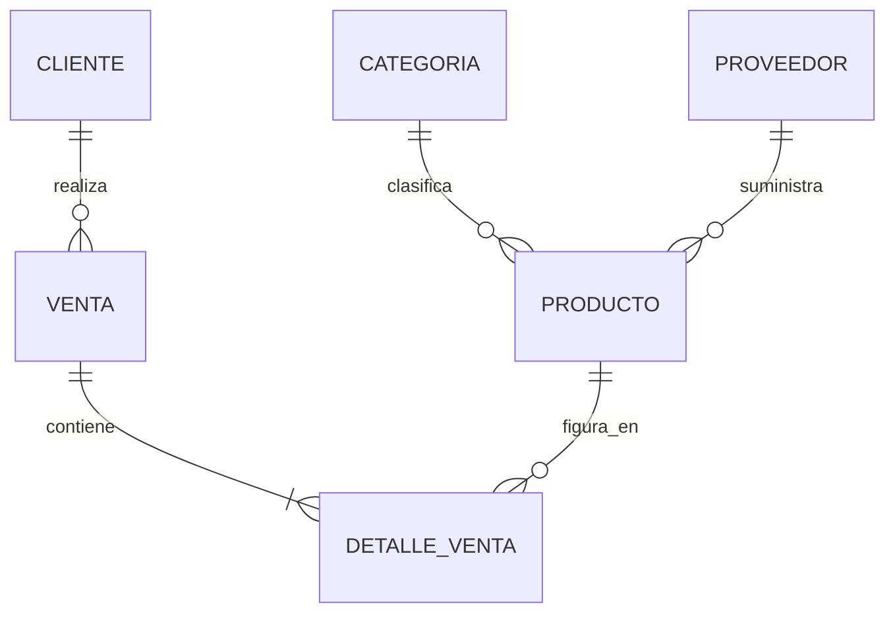

# Minimarket | Inventario y ventas

Proyecto universitario de base de datos. Registra productos y ventas en una aplicación web local y demuestra cómo SQL Server conserva las relaciones, el historial de precios y la integridad del inventario.

**Frontend:** HTML, CSS y JavaScript · **Backend:** Python y Flask · **Base de datos:** SQL Server mediante ODBC.

Consulta el [informe y guion de sustentación](docs/Informe-y-sustentacion.pdf) para revisar el modelo, la transacción y la presentación de cinco minutos.

## Qué puedes demostrar

| Pantalla | Operación | Concepto de base de datos |
|---|---|---|
| Resumen | Ventas del día, actividad semanal y alertas de stock | Conteos, sumas y agrupación por fecha |
| Inventario | Búsqueda, filtros, registro y edición de los datos del producto | JOIN, claves foráneas y restricciones |
| Nueva venta | Venta de varios productos y descuento de stock | Transacción, bloqueo y precisión decimal |
| Historial | Filtro por fechas y detalle de cada venta | Relación 1 a N, índice por fecha y precio histórico |
| Catálogos | Registro y consulta de categorías, proveedores y clientes | Integridad referencial |

## Instalar en Windows

### 1. Preparar SQL Server

Instala **SQL Server 2022 Express o Developer**, **SQL Server Management Studio (SSMS)** y el **Microsoft ODBC Driver 18 for SQL Server**. El motor, el administrador y el controlador son tres componentes distintos. En SSMS conéctate a tu instancia local. En una instalación Express suele llamarse `localhost\SQLEXPRESS`. En una instancia predeterminada puede ser `localhost`.

Abre cada archivo en SSMS y ejecútalo en este orden:

1. [01_crear_base.sql](sql/01_crear_base.sql) crea `MinimarketDB` y sus seis tablas.
2. [02_datos_ejemplo.sql](sql/02_datos_ejemplo.sql) carga datos ficticios y doce ventas si los catálogos están vacíos.
3. [03_vistas_e_indices.sql](sql/03_vistas_e_indices.sql) crea las vistas e índices que usa la aplicación.
4. [04_consultas_sustentacion.sql](sql/04_consultas_sustentacion.sql) contiene consultas de lectura para la exposición. Es opcional para arrancar.

La cuenta usada en SSMS debe poder crear la base. Los scripts de instalación pueden ejecutarse de nuevo sobre la estructura de este proyecto. Si ya instalaste la primera versión, ejecuta del 01 al 03 sobre la misma instancia. Los registros existentes se conservan y se omite la carga de ejemplo.

### 2. Ejecutar la aplicación

Instala **Python 3.10 a 3.13**. Abre PowerShell en la carpeta descomprimida, junto a `app.py`:

```powershell
py -m venv .venv
.\.venv\Scripts\python.exe -m pip install -r requirements.txt
Copy-Item .env.example .env
notepad .env
```

En `.env`, cambia el valor de `SERVER` por el nombre con el que te conectaste en SSMS. La línea activa del ejemplo utiliza autenticación de Windows. Para autenticación SQL comenta esa línea, activa la alternativa e introduce tu cuenta local. Conserva `DATABASE=MinimarketDB` y usa una cuenta con permiso para consultar y modificar las tablas.

```powershell
.\.venv\Scripts\python.exe app.py
```

Abre **http://127.0.0.1:5000** en el navegador. El panel debe mostrar **SQL Server · Conectado**. Mantén el motor y Flask encendidos durante la exposición. Detén Flask con `Ctrl+C`.

La instalación de paquetes puede requerir internet. Una vez instalada, la aplicación funciona íntegramente en el equipo, incluidos los íconos y el gráfico. El repositorio de GitHub se usa para entregar el código.

### Opción con Docker en Linux

Si ya tienes Docker en un equipo x86-64, puedes utilizar la [imagen oficial de SQL Server](https://learn.microsoft.com/sql/linux/sql-server-linux-docker-container-deployment). Expón el puerto solo en la interfaz local, ejecuta los scripts con un cliente SQL y usa la línea de autenticación SQL de `.env.example`. Instala el controlador ODBC 18 en el equipo donde corre Python. Para el entorno virtual usa `python3 -m venv .venv`, `.venv/bin/python -m pip install -r requirements.txt` y `.venv/bin/python app.py`.

## Presentación rápida

1. Abre **Resumen** y muestra qué datos vienen de SQL Server.
2. En **Inventario** busca «Agua 625 ml». Con los datos recién cargados tiene **30 unidades** a **S/ 2.50**.
3. En **Nueva venta** selecciona «Público general» y registra **2 aguas** y **1 jugo de naranja**. El total es **S/ 12.50**. Los stocks quedan en **28** y **11**.
4. En **Historial** abre la venta y compara sus dos líneas con los datos de SQL Server. Ejecuta la tercera consulta de `04_consultas_sustentacion.sql`.
5. Intenta agregar más agua de la disponible. Muestra el rechazo y comprueba que el stock no cambia.

## Modelo y alcance



La relación entre **Venta** y **Producto** se resuelve con **Detalle_Venta**. La aplicación requiere al menos una línea por venta. El detalle toma el precio vigente al confirmar y lo conserva aunque el producto cambie de precio después. La edición de un producto no modifica su stock.

El alcance se centra en inventario de salida y ventas. La entidad **Compra** del diagrama de partida necesitaría un detalle de compras para registrar sus productos y cantidades. Se deja como ampliación junto con la reposición de stock, el acceso por usuario y la anulación de ventas.

```text
app.py       Rutas, validaciones y transacción de venta
templates/  Interfaz HTML
static/     JavaScript, estilos e íconos locales
sql/        Tablas, ejemplos, vistas, índices y consultas
docs/       Informe con modelo, verificación y guion de exposición
```

## Si algo falla

- **Sin conexión con la base:** verifica que el motor esté iniciado y que el servidor de `.env` coincida con SSMS. Confirma que estás usando `MinimarketDB` y que ejecutaste el script 03.
- **Controlador ODBC ausente:** instala el Microsoft ODBC Driver 18 y conserva el nombre exacto de la línea de ejemplo.
- **Puerto ocupado:** define `APP_PORT=5001` en `.env`, reinicia Flask y abre el puerto indicado.
- **Contraseña con punto y coma:** en una cadena ODBC encierra el valor en llaves, por ejemplo `PWD={tu;contraseña}`. Si el valor contiene una llave de cierre, escápala duplicándola.

## Entrega en GitHub

Descomprime el ZIP. Sube los archivos dentro de la carpeta `minimarket` a la raíz del repositorio, incluido el archivo `.env.example`. El `.gitignore` excluye `.env`, el entorno virtual y archivos temporales. El archivo `.env` permanece en tu computadora.
